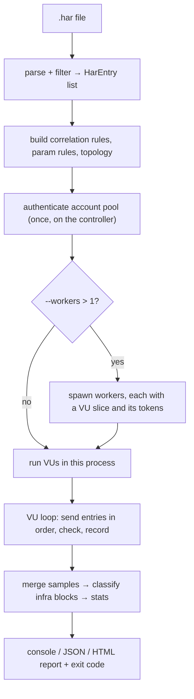

# jac-loadtest Architecture

`jac-loadtest` replays a recorded browser session (a HAR file) under load against a target and
reports latency, errors and throughput. The HAR is the test script; the only configuration is the
load shape. It is a standalone package, jac-scale-aware but not part of jac-scale.

## Module map

```
jac_loadtest_cli/
├── plugin.jac          argparse entry point (the `loadtest` console script)
├── cli.jac             flag wiring, run orchestration, exit codes
├── headless.jac        run_test_headless(): CLI-free entry point for embedders
├── config.jac          LoadTestConfig; CLI flags → jac.toml → built-in defaults
├── core/               generic engine
│   ├── har_parser.jac      parse HAR, filter, rewrite URLs, tag ws/graphql entries
│   ├── engine.jac          asyncio VU loop, load modes, assertions, poll blocks
│   ├── correlation.jac     detect and apply per-VU response → request value threading
│   ├── parameterize.jac    {{tokens}} and --param substitution
│   ├── infra_block.jac     classify WAF/rate-limit deny pages; proxy pool
│   ├── ws_engine.jac       WebSocket VU coroutine
│   ├── graphql_engine.jac  graphql-ws subscription VU coroutine
│   ├── protocols.jac       run HTTP + ws + graphql together on one collector
│   ├── process_runner.jac  multi-process controller: slicing, merging, fleet abort
│   └── metrics.jac         per-request records, histograms, percentiles
├── bridge/             jac-scale-aware adapters
│   ├── auth.jac            login/register, account pool, re-auth, JWT injection
│   ├── body_check.jac      failure-inside-200 and shape-drift detection
│   └── topology.jac        path prefix → service URL routing
├── output/reporter.jac     console (Rich), JSON, HTML reports
└── templates/              self-contained HTML report (Chart.js vendored)
```

**Dependencies.** The leaf modules (`har_parser`, `metrics`, `correlation`, `parameterize`,
`infra_block`, `ws_engine`, `graphql_engine`) never import `bridge/`. `engine`, `protocols` and
`process_runner` call into `bridge/` for auth, routing and the body check. `bridge/` is the only
place jac-scale's contracts are encoded: to adapt the tool to another server's conventions, change
`bridge/`, not the engine.

## Run lifecycle



Each VU is an asyncio coroutine with its own `aiohttp` session, cookie jar and token. Closed-loop
mode replays the HAR per VU; `--open-loop` starts a session every `1/rps` s regardless of response
time; `--step-load` adds VUs in steps until a threshold breaks and reports the capacity knee. Ctrl+C
once stops gracefully with a partial report; twice aborts.

## HAR parsing

`parse_har()` keeps API traffic and drops what cannot be replayed: static assets (unless
`--include-static`), `document`/`font`/`media`/`eventsource` resource types, cache-busting URLs,
and POST/PUT/PATCH entries whose body was not captured. It strips `Authorization`, `Cookie`,
`Host`, `Content-Length` and HTTP/2 pseudo-headers, rewrites the origin to `--url`, and tags each
entry with a protocol (`http`, `graphql`, `ws`, `graphql_ws`). WebSocket and GraphQL entries are
routed to their own adapters automatically. Each `HarEntry` also carries the expected status, the
recorded response body (used by correlation and the body check) and adjacent-repeat counters (used
by `--poll-until`).

## Mechanisms

**Correlation.** A static scan of the HAR finds values (8–512 characters, id-like, produced by
exactly one response) that a later request reuses. Each VU threads the value *it* received, per
iteration. `--correlate` and `x-jac-correlate` add explicit rules. A missing value fails the
consumer as `CORRELATION_MISS` instead of sending a stale id. Correlation runs before
parameterization.

**Parameterization.** `{{uuid}}`, `{{vu_id}}`, `{{iter}}`, `{{randint:a,b}}`, `{{now±}}`,
`{{account.<col>}}`, `{{env.<VAR>}}` expand in bodies, queries, headers and paths; `--param` draws a
field from a file, advancing by `(vu_id, iteration)`. Unknown tokens are left as written.

**Auth.** The whole account pool is authenticated once on the controller (one login per distinct
account, optionally paced) and each worker receives only its slice of tokens. A missing account is
registered on demand; the register response (`201` vs `400 USER_EXISTS`) tells a missing account
from a wrong password. A `401` mid-run triggers one re-login per account (deduplicated across VUs)
and one retry; a second `401` is `AUTH_EXPIRED`.

**Error classes.** Each class has its own `error_type` and breakdown bucket: transport errors
(`TIMEOUT`, `DNS_ERROR`, …), status mismatch, `ASSERTION_FAILED`, `APP_ERROR_IN_200`,
`SHAPE_DRIFT`, `CORRELATION_MISS`, `AUTH_EXPIRED`, `POLL_TIMEOUT`/`POLL_TERMINAL_ERROR`, and
`INFRA_BLOCK_SUSPECTED`. The last is decided after the run: a byte-identical non-JSON body across
at least `--infra-block-threshold` endpoints in one 10 s bucket is a WAF page, not an application
error. Blocked responses are excluded from the success-rate denominator.

**Poll blocks.** For two or more adjacent recorded calls to the same path matched by a
`--poll-until` rule, the engine re-sends the block's request until a JSON field reaches a terminal
value or `--poll-timeout` passes, then records one result with the real wait as its latency.

**Metrics.** Raw samples are kept in a bounded deque (`--max-samples`) for percentiles, with an
exact request counter and 10 s time series generated after the run. Endpoints are normalized
(`/walker/user/123` → `/walker/user/{id}`) and grouped by `(protocol, endpoint)`. Timeouts and
transport failures never enter latency percentiles.

**Protocol adapters.** `ws_engine` sends the recorded frames and records one sample per message
(plus a `[connect]` row); `graphql_engine` runs a `graphql-ws` subscription and records one sample
per event. Both write to the same collector as the HTTP engine.

**Topology.** Monolith mode sends everything to `--url`. Microservice mode routes by longest path
prefix (from `jac.toml` plus `JAC_SV_*_URL` env vars, or `--services-map`), strips the prefix like
the jac-scale gateway, and reports per service.

## Multi-process execution

With `--workers N` the controller slices VUs (and WebSocket/GraphQL scenario VUs) across spawned
workers, pre-authenticates the pool, and pre-resolves DNS. Workers stream latency histograms; the
controller sums them for exact live percentiles, makes the single `--abort-on-fail` decision on
merged traffic, and signals workers through a shared stop event. Final percentiles are recomputed
from the merged samples. `--step-load` is single-process only.

## Reports

Console (Rich, stderr), JSON (stdout or `--report-out`) and HTML (file only, fully offline). JSON
top-level keys: `meta`, `latency_benchmarks`, `endpoints`, `summary`, `cumulative_timeseries`,
`interval_timeseries`, `step_load`, `capacity_knee_vus`. Each endpoint carries percentiles with
Good/Acceptable/Bad ratings (overridable per endpoint with `--slo`), Apdex, TTFB, RPS, error and
infra-block counts and an error breakdown with sample trace IDs. Human output goes to stderr so
stdout stays machine-readable.

## Headless use

`run_test_headless(config, on_snapshot=, stop_event=, on_html_report=)` runs the same pipeline as
the CLI with no argparse, Rich output, `sys.exit()` or file writes, and returns the JSON report as
a dict. `LoadTestConfig.from_dict()` builds a config from a plain dict. Pass `workers=1` for a
request-scoped embedder.

## Limitations and roadmap

Current limitations: [`CONSTRAINTS.md`](CONSTRAINTS.md). Planned work: [`ROADMAP.md`](ROADMAP.md).
